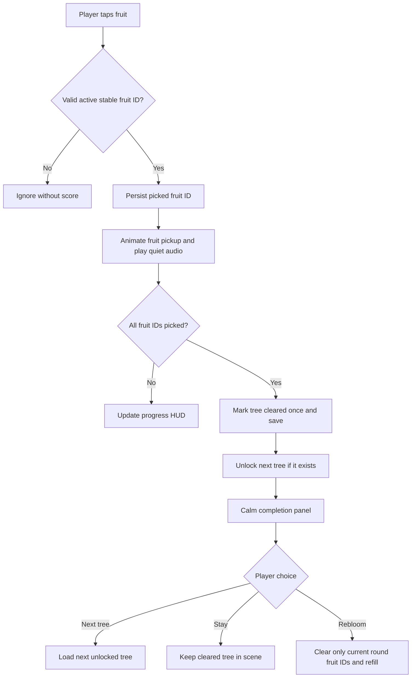

# Fruit Tree — Unity gameplay architecture

**Status:** proposed target design for the new multi-tree progression. Current repo still runs a single 30-apple procedural tree. This is a migration specification; it is **not** a claim that these systems are implemented.

## Architectural objectives

- Unity 6000.6.5f1, Android portrait, offline-first, no backend.
- One tree instantiated at a time; seamless next tree / returning to replay.
- Deterministic fruit identity independent of Unity runtime instance IDs.
- A strict 100%-clear unlock rule and durable replayable tree states.
- Separately testable pure gameplay rules, Unity presentation, and persistence.
- Support 100–300 visible and pickable fruit per tree on mobile after profiling.
- Keep existing OrbitPickingCamera, tree generation, HarvestHUD, Pause, and IAP flows working during migration.

## Domain objects

### TreeDefinition (ScriptableObject)

Immutable authored configuration:

`treeId`, `order`, `displayNameKey`, `speciesId`, `fruitKindId`, `fruitCount`, `generationSeed`, `treePrefab` or `generationProfile`, `fruitPrefab`, `leafProfile`, `atmosphereProfile`, `soundProfile`.

Future resource references are optional for generated prototype trees; IDs and order are required and must not change once published.

### TreeCatalog (ScriptableObject)

Ordered definitions with unique stable IDs. First entry is initially unlocked. All subsequent entries unlock **only when the immediately preceding tree is cleared at least once**. Never infer IDs from array index in saved progress.

Catalog validation (Editor): duplicate IDs, missing prefabs, negative counts, unreachable fruit slots, non-sequential order, unsupported model references.

### OrchardProgress (versioned JSON)

Example:
```json
{
  "schemaVersion": 1,
  "currentTreeId": "tree_001",
  "trees": [
    {
      "treeId": "tree_001",
      "unlocked": true,
      "completedOnce": true,
      "timesCleared": 1,
      "roundNumber": 2,
      "pickedFruitIds": ["fruit_0007", "fruit_0010"]
    },
    {
      "treeId": "tree_002",
      "unlocked": true,
      "completedOnce": false,
      "timesCleared": 0,
      "roundNumber": 1,
      "pickedFruitIds": []
    }
  ]
}
```

Store under `Application.persistentDataPath` as a versioned JSON document, with atomic-ish write to `.tmp`, replace or fallback backup, and recovery. Consider a small checksum/hash for corruption detection (not an anti-cheat security claim). Flush after meaningful batches, on app pause/quit and immediately on unlock/clear/rebloom. Local autosave failure must never silently overwrite a good backup.

**Old prototype migration:** today's 30-apple `PlayerPrefs` stores only `FruitTree.Best`, not each fruit's picked identity. Preserve it as legacy best-stat metadata if wanted, but **do not invent** per-fruit collection or automatic unlock from it. Migration starts the new stable tree collection cleanly and documents why.

### TreeRoundState (pure logic)

Inputs: `treeId`, `fruitIds`, `pickedFruitIds`, `completedOnce`, `timesCleared`.

Behaviors:
- `TryPick(fruitId)`: rejects unknown or repeated IDs, returns progress.
- `IsCleared`: picked count equals current definition's **reachable** stable fruit set count.
- `ClearCompleted`: idempotent, records first-time completion and number of fully cleared rounds exactly once, emits unlock event.
- `Rebloom`: valid only when cleared, increments roundNumber and clears picked IDs; retains completedOnce, timesCleared.
- Full clearing cannot be faked by a count alone; derive from unique fruit IDs.

### OrchardProgressionService (pure logic)

- Loads catalog + save; first tree starts unlocked.
- `Pick(treeId, fruitId)` records only on current accessible tree.
- When a tree clears for the first time, unlock the next catalog entry.
- Replay completion may increase timesCleared, but never unlock backwards or revoke access.
- Locked tree cannot be selected with UI or a crafted save value without validation.
- Selecting an unlocked tree keeps all other trees' states.
- Exposes `CurrentTree`, `UnlockedTrees`, `CompletionStatus`, `SelectTree`, `RebloomTree`.

### FruitInstance / IFruitCollectible

The current `Apple` component supports animation and collider interaction. During migration:
- extract shared `FruitCollectible` with `StableFruitId` and `FruitKindId`;
- `TryPick` calls the service before visual collection is finalized;
- apple/pear/cherry render meshes and sounds are per-species presentation, not distinct progression rules;
- `ResetVisual` for rebloom does not overwrite the saved unlock state.

### TreeScenePresenter / TreeFactory

- Loads a single TreeDefinition into one tree presentation instance.
- Instantiates authored tree or procedural prototype profile and validates all stable fruit IDs.
- Applies saved picked IDs at startup **without** re-firing harvest events.
- Avoids repeated mesh allocations when switching/reblooming, via pooling/caching when profiling warrants it.
- Reports eligible targets to the final-fruit gentle hint system.
- Existing OrbitPickingCamera binds to the active tree root; its behavior remains unchanged.

### TreeSelection UI / Completion UI

Collection preview: locked silhouettes, opened trees, cleared marker, per-tree `collected / total`. The next tree is interactable only after unlock. Calm end-of-tree screen with three actions: **Next tree**, **Stay**, **Rebloom** (available on cleared tree). No forced timeout, no payment or ad.

Minimal localization: KZ/RU initially, English later. Text keys, not display strings, live in definitions.

## Event flow



## Stable fruit placement contract

Each tree has `fruit_0000` ... `fruit_N` identifiers assigned when the level is authored/generation slots are established. IDs **must survive code upgrades**: changing procedural geometry or shuffling positions must not change the identity of existing fruit slots. The current single-tree generator randomizes/shuffles anchors and is **not yet safe** to use directly for saved 100% progression. Replace with persisted authored slots or a deterministic, versioned slot mapping before enabling saves.

Fruit count is set per species/config. Do not silently increase an already published tree's count and invalidate a previous fully cleared save; use slot-set versioning and migration rules.

When `Application` exits mid-session, the scene restores exact remaining picked IDs. After picking every fruit, the next tree unlock is written before showing the visual celebration.

## Performance approach

- Start with 3-tree vertical slice: apple ~120, pear ~140, cherry ~220 fruit.
- Combine static wood / foliage meshes, avoid tens of thousands of GameObjects for leaves.
- Target at most one active tree's leaves/branches/fruit renderers; inactive trees are unloaded.
- Fruit visuals: shared mesh/material and batched instancing when profiling shows cost; maintain accessible collider proxies for touch selection.
- Avoid per-frame allocations on orbit/picking; throttle autosave and audio variation.
- Reduce leaf density, shadow resolution, fruit visibility effects on low-end Android.
- Verify on real device: 30 FPS low-end target, 60 FPS mid-range target; startup memory/battery/heat matter as much as draw calls.

## Code organization (target)

```
Assets/
  Scripts/
    Core/                       # no Unity-dependent business decisions
      TreeProgress.cs
      OrchardProgressionService.cs
      OrchardSaveModel.cs
    Catalog/
      TreeDefinition.cs
      TreeCatalog.cs
    Game/
      OrchardGameController.cs
      FruitCollectible.cs
      TreeScenePresenter.cs
      HarvestCompletionController.cs
    Persistence/
      JsonOrchardSaveRepository.cs
    UI/
      TreeSelectionView.cs
      CompletionView.cs
      RemainingFruitHint.cs
    Legacy/
      TreeGenerator.cs          # migrate incrementally
      Apple.cs
```

Folder names are **planned**, not all present yet. Avoid moving current files without Unity serialization GUID migration; preserve .meta asset identity.

## Testing matrix

| Test | Expected outcome |
|---|---|
| Begin new save | Only tree_001 unlocked |
| Pick 119/120 | Tree_002 remains locked |
| Pick last of 120 | Tree_001 cleared; Tree_002 unlocked once |
| Tap same fruit twice | No double increment / duplicate persistence |
| Reload at 72/120 | Exactly 72 picked, 48 visible fruits remain |
| Close app during round | State survives and no negative score |
| Rebloom cleared tree | Full fruit refill without revoking unlocked trees |
| Try rebloom at 99% | Rejected, remaining fruit unchanged |
| Replay old tree | Later tree unlocks remain |
| Corrupt save | Recover backup or safe new-save prompt, no silent data loss |
| Reorder catalog in patch | Stable IDs maintain unlock state |
| 220 cherries | On-device profile and final-fruit audit pass |

## Delivery phases

1. **Design + data contracts** — GDD and architecture, acceptance tests, IDs and migration plan.
2. **Three-tree vertical slice** — apple/pear/cherry catalog, saves, 100%-unlock, rebloom, selection UI.
3. **Art and comfort** — distinctive tree/fruit shapes, mellow lighting/audio, gentle final-fruit aids.
4. **Expand to 10 trees** — content pipeline with validation, balancing and QA.
5. **Android release** — profile, billing/ads policy (only after provider), localization, signing, store listing.

**Current repository status:** phase 1 documentation; no automatic claim of phases 2–5. The existing apple-only game is a prototype and remains playable until the new system is integrated and tested.
